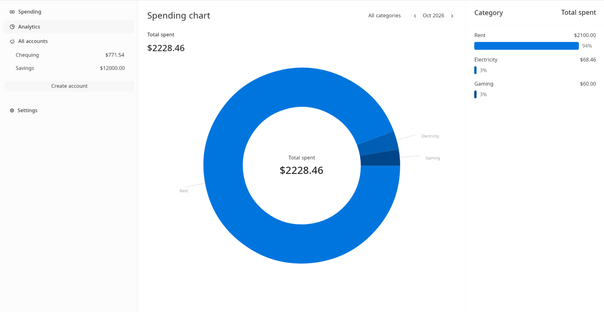

<h1 align="center">
  
  <br>
  <span>Mukwa</span>
</h1>
<p align="center">
  
</p>

## Overview

Mukwa is a free and open source personal finance app. It is designed to be simple to use and get out of your way. Mukwa is "local first", meaning all your sensitive financial data is stored locally on your device, no internet connections, no data sent to the cloud.

## Installation

<h3>
  <picture>
    <source media="(prefers-color-scheme: dark)" srcset="./assets/windows_dark.svg">
    <source media="(prefers-color-scheme: light)" srcset="./assets/windows_light.svg">
    
  </picture>
  <span>Windows</span>
</h3>

Download the installer for [Intel/AMD](https://github.com/snubwoody/mukwa/releases/latest/download/Mukwa-x86_64-Setup.exe) or [ARM64](https://github.com/snubwoody/mukwa/releases/latest/download/Mukwa-aarch64-Setup.exe).

Or install via [Winget](https://winstall.app/apps/Wakunguma.Mukwa).

```powershell
winget install -e --id Wakunguma.Mukwa
```

<h3>
  <picture>
    <source media="(prefers-color-scheme: dark)" srcset="./assets/linux_dark.svg">
    <source media="(prefers-color-scheme: light)" srcset="./assets/linux_light.svg">
    
  </picture>
  <span>Linux</span>
</h3>

Download the [AppImage](https://github.com/snubwoody/mukwa/releases/latest/download/Mukwa-x86_64.AppImage), [Deb](https://github.com/snubwoody/mukwa/releases/latest/download/Mukwa-x86_64.deb) or [tarball](https://github.com/snubwoody/mukwa/releases/latest/download/mukwa-x86_64.tar.gz).

## Contributing

If you have any ideas, issues, etc. regarding Mukwa, or would like to contribute to Mukwa through pull requests, please check out the ["Contributing"](./CONTRIBUTING.md) document.

## License

Mukwa is licensed under the [GPL V3](https://www.gnu.org/licenses/gpl-3.0.en.html) license, see the [LICENSE](./LICENSE)
file for details.
